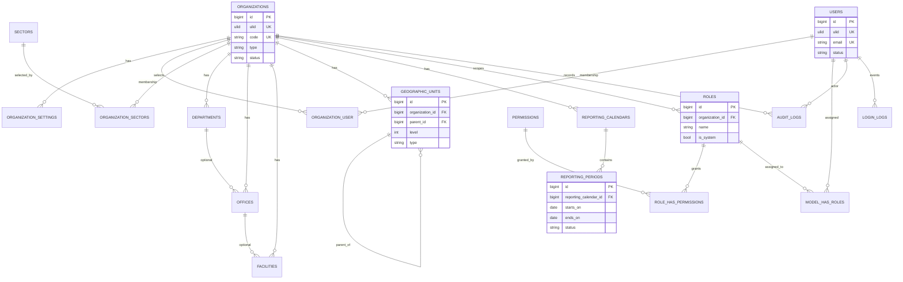

# MEAL MASTER – Phase 1 ERD

## Relationship rules

1. `geographic_units.parent_id` must reference the same `organization_id`.
2. Spatie `model_has_roles.organization_id` binds role assignment to a tenant.
3. `reporting_periods.organization_id` denormalizes calendar ownership for isolation queries.
4. Audit logs may have null organization for platform-level events.
