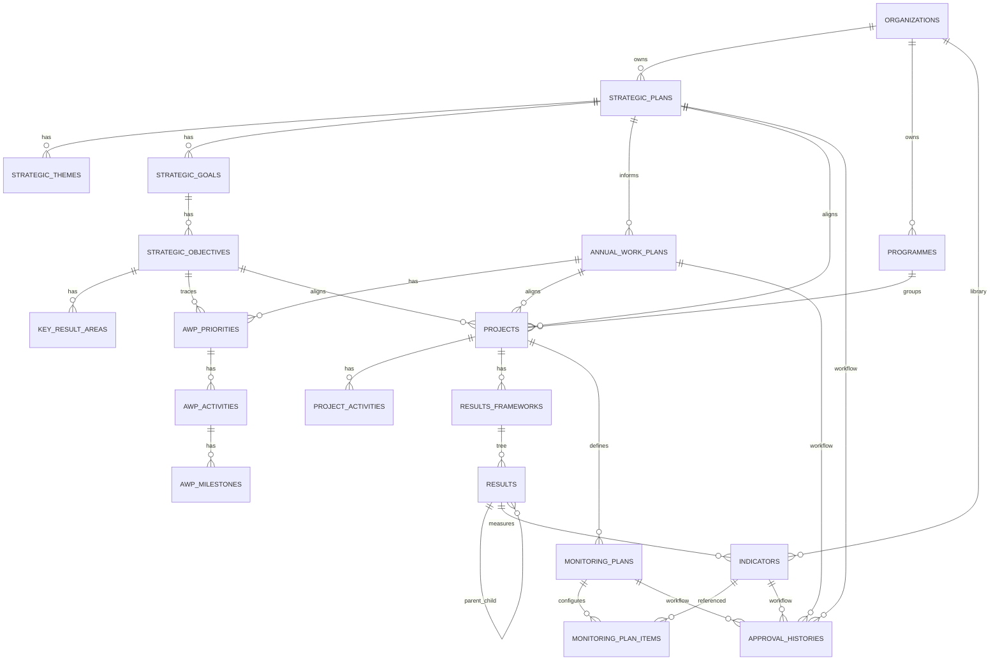

# MEAL MASTER — Phase 2 ERD

## Traceability path

Strategic Plan → Goal → Objective → AWP Priority → Project → Results Framework Result → Indicator → Monitoring Plan Item

## Version lineage

- `strategic_plans.parent_plan_id`
- `indicators.parent_indicator_id`
- `monitoring_plans.parent_monitoring_plan_id`
- `results_frameworks.parent_framework_id`
- `annual_work_plans.parent_awp_id`